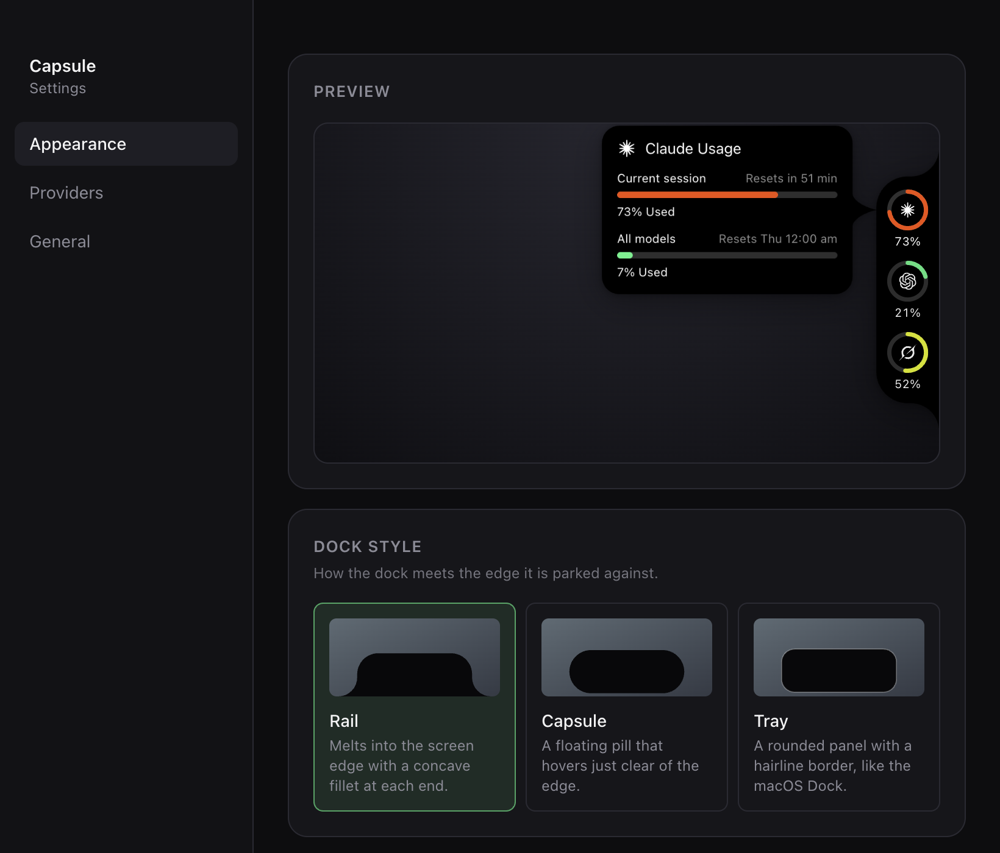
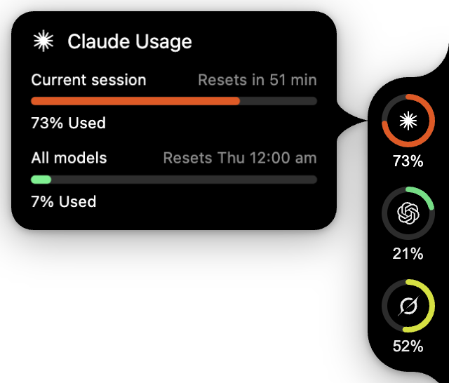
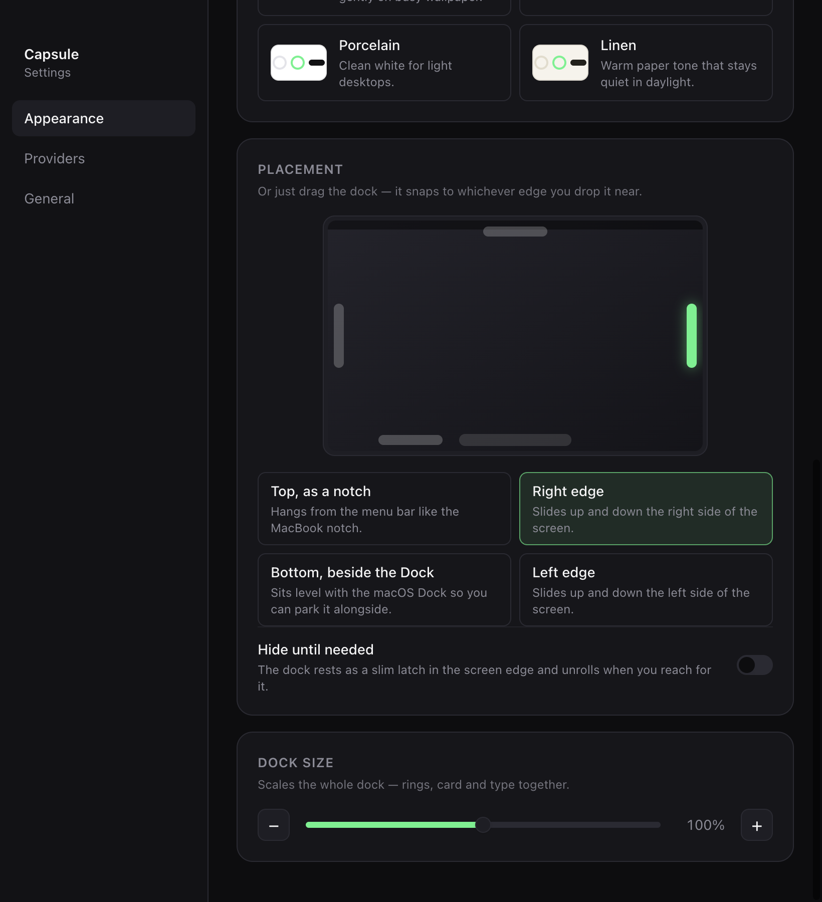

<div align="center">

# Capsule

### A quiet edge dock for your AI coding tools

Capsule keeps usage limits, local agent activity, and reset times at the edge
of your Mac—visible when you need them and folded away when you do not.



<sub>Captured from Capsule on macOS with its built-in demo data.</sub>

</div>

## At a glance

- See usage for Claude, Codex, Grok, and Cursor.
- Know when local Claude Code, Codex, or Grok sessions are working, waiting,
  or finished.
- Get small, non-blocking activity notices without leaving your current app.
- Check Claude and Codex token totals for today and the last 30 days.
- Park the dock on any screen edge, resize it, or let it fold into a slim latch.
- Choose light or dark themes and Rail, Capsule, or Tray dock styles.

<p align="center">
  
</p>

## Make it yours

Choose a theme, move Capsule to any screen edge, control when it folds away,
and scale the whole dock from one place.

<p align="center">
  
</p>

## Provider support

| Provider | Usage | Activity notices | Local token totals |
| --- | :---: | :---: | :---: |
| Claude | Yes | Yes | Yes |
| Codex | Yes | Yes | Yes |
| Grok | Yes | Yes | — |
| Cursor | Yes | — | — |

Claude, Codex, and Grok are enabled by default. Cursor can be enabled from
**Settings → Providers**.

## How it works

Capsule reuses sessions already stored by the tools on your Mac. It does not
ask you to create another account or sign in again. Usage readers contact each
provider's usage service; activity and token counts come from bounded reads of
local session records.

The dock keeps the last good reading when a refresh fails and marks it as
stale instead of inventing a number. Provider endpoints and local file formats
can change, so an installed tool may occasionally show as unavailable until
Capsule is updated.

Activity notices are passive. Capsule does not install hooks, send prompts,
approve actions, or control an agent. The experimental agent chat is not part
of the app; its source is kept in git history at the `electron-final` tag.

## Install

Download the latest `.dmg` from
[Releases](https://github.com/antick/capsule/releases), open it, and drag
Capsule to Applications. Capsule is a native Swift app and needs an Apple
silicon Mac on macOS 14 Sonoma or newer. Intel Macs stay on the final Electron
release, `v0.1.0`.

Capsule lives in the menu bar, not the Dock. On first launch it parks itself on
the right edge of your screen; right-click it or use the menu bar icon for
**Settings**. Settings from the Electron version are carried over on first
launch.

Releases are not yet signed with an Apple Developer ID, so macOS refuses to
open the download the first time:

1. Open **System Settings → Privacy & Security**
2. Scroll to the message about Capsule being blocked, and click **Open Anyway**
3. Confirm in the dialog that follows

## Updates

**Settings → Updates** shows the running version and checks GitHub Releases
for a newer one, on launch and once a day unless you turn that off. A release
that is found is downloaded from its release page; installing in place arrives
with signed releases. The check sends nothing but the request for the latest
release.

## Run it locally

Capsule needs macOS 14 or newer on Apple silicon, and Xcode with Swift 6.

```bash
scripts/bundle-macos.sh
open .build/out/Products/Debug/Capsule.app
```

Right-click the dock for **Settings**, **Keep open**, placement shortcuts, and
**Quit Capsule**. You can also use the menu bar icon. Turn on **Demo mode** in
Settings to explore the full interface without provider accounts.

## Check a change

```bash
swift build
swift test
scripts/test-scripts.sh
```

`swift test --filter CapsuleSnapshotTests` renders every dock state and every
settings page to PNG under `.build/snapshots`, for looking at a change rather
than imagining it.

Build an installable app without publishing it — the zip and the DMG land in
`.build/release-artifacts`:

```bash
scripts/package-macos.sh
```

## Cut a release

1. Bump `CFBundleShortVersionString` in `Support/CapsuleApp/Info.plist`
2. Add a `## <version>` section to `CHANGELOG.md`
3. Commit both
4. Run `scripts/tag-release.sh`, then push the tag it prints

Pushing the tag runs the Release workflow: it re-runs the tests, builds the
app, and publishes it to GitHub Releases. The changelog section becomes both the
release body and the "What's new" text in Settings → Updates.

Signing and notarising the build is set up once, in
[docs/releasing.md](docs/releasing.md).

## License

Capsule is free software under the
[GNU General Public License v3.0 or later](LICENSE). You can use, study,
change, and share it. If you share a changed version, you must release its
source code under the same license.
