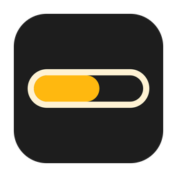
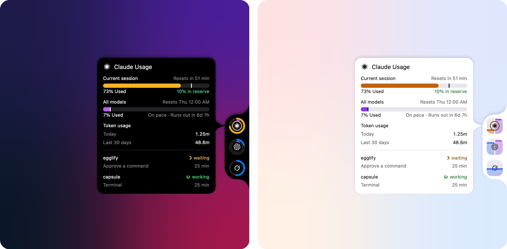
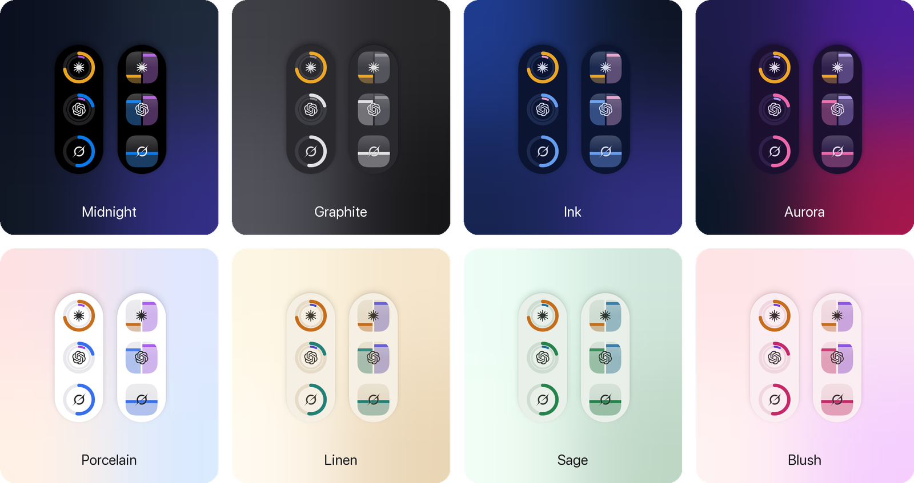
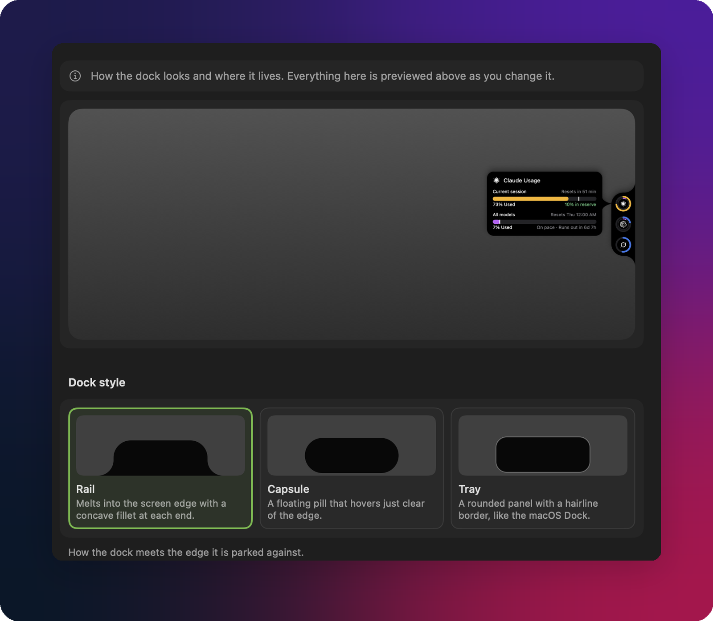
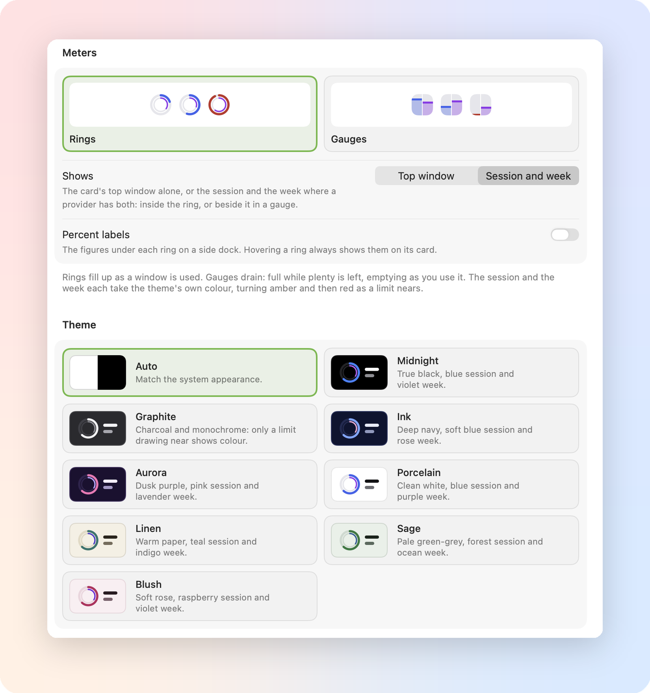

<div align="center">



# Capsule

**Your AI coding limits, parked at the edge of your screen.**

Claude, Codex, Grok, Cursor and more: every session and weekly limit in one
small dock that stays out of the way until you glance at it.

[](https://github.com/antick/capsule/releases)


[](LICENSE)

[Install](#install) · [Features](#what-it-does) · [Themes](#eight-themes) · [Providers](#providers) · [Command line](#command-line) · [Build it](#build-it-yourself)

<br>



</div>

<br>

## Why Capsule

You're deep in a task, an agent is running, and then you hit the limit you
didn't see coming. Capsule puts every limit where your eyes already go, the
edge of the screen, as a ring or a gauge per provider. Hover one and its card
opens with everything: each window, when it resets, whether you're ahead of
pace, what your agents are doing, and what today cost.

It reads the logins your tools already keep on this Mac. No new account, no
extra sign-in, and nothing leaves your machine except the providers' own usage
requests.

## What it does

|  |  |
| --- | --- |
| 🎯 **Session and week at a glance** | Two rings per provider, or a gauge that drains as you use it. Each window has its own colour, turning amber, then red, as a limit gets close. |
| 🏃 **Pace, not just percent** | Every window shows whether you're ahead of an even pace and when it runs out at your current rate. |
| 🤖 **Agent activity** | See when Claude Code, Codex or Grok sessions are working, waiting on you, or done, with quiet notices that never steal focus. |
| 💸 **Tokens and spend** | Today's and the last 30 days' tokens, with an estimated cost at list price from local logs. |
| 👥 **Every account** | Add as many Claude Code and Codex accounts as you use, found automatically or by folder, each named the way you like. |
| 🔔 **Heads-up alerts** | A notification when a window crosses 50% or 20% left (or your own thresholds), and a small celebration when the week resets. |
| 🚦 **Provider status** | An incident on a provider's status page puts a dot on its ring. |
| 📈 **History** | Two weeks of readings per window, drawn per provider. |
| 🔋 **Easy on the battery** | Reads more often while agents work and less while you're away, and backs off on Low Power Mode. |
| ⌨️ **Scriptable** | `capsule --pretty` prints the same limits as JSON for scripts and agents. |

## Eight themes

Four dark and four light, each with its own surface and its own pair of meter
colours. Pick rings or gauges in **Settings → Appearance**; **Auto** follows
macOS between Midnight and Porcelain.

<p align="center">
  
</p>

## Make it yours

Park it on any edge as a rail that melts into the screen, a floating capsule,
or a tray. Resize the dock without touching the cards, let it fold into a slim
latch when you're not looking, or keep it in the menu bar instead with the
figures you choose.

<p align="center">
  
</p>

<table>
  <tr>
    <td width="50%"></td>
    <td width="50%"></td>
  </tr>
  <tr>
    <td align="center"><sub>Every change is previewed live</sub></td>
    <td align="center"><sub>Rings or gauges, and a theme to match</sub></td>
  </tr>
</table>

## Install

```sh
brew install --cask antick/tap/capsule
```

Or grab the `.dmg` from [Releases](https://github.com/antick/capsule/releases)
and drag Capsule to Applications. Releases are signed with Developer ID and
notarized by Apple.

Capsule needs **macOS 14 Sonoma or newer on Apple silicon**. On first launch it
parks on the right edge of your screen. Right-click the dock for **Settings**,
or choose **Menu bar** or **Both** under **Settings → Menu bar** for a
menu-bar item too.

Updates arrive through **Settings → Updates**: signed releases, checked
shortly after launch and once a day. Update checks talk to GitHub only; your
credentials and readings never go there.

## Providers

| Provider | Usage | Agent activity | Tokens and spend | Status page | Signs in with |
| --- | :---: | :---: | :---: | :---: | --- |
| Claude | ✓ | ✓ | ✓ | ✓ | Claude Code's login; more accounts by folder |
| Codex | ✓ | ✓ | ✓ | ✓ | Codex's login; more accounts by folder |
| Grok | ✓ | ✓ | ✓ | — | Grok CLI's login |
| Cursor | ✓ | — | Spend | ✓ | Cursor's login |
| Antigravity | ✓ | — | — | ✓ | The running app, or its saved login |
| Devin | ✓ | — | — | — | Devin's app login, or a pasted key |
| OpenRouter | Balance, spend | — | — | — | Pasted API key |
| DeepSeek | Balance | — | — | — | Pasted API key |

Claude, Codex and Grok are on by default; switch the rest on in
**Settings → Providers**. Keys you paste are kept in an owner-only file and
never shown again. Spend is an estimate at list price, not a bill.

## Command line

Install `capsule` from **Settings → General → Command line** (a link in
`~/.local/bin`), then:

```sh
capsule --pretty            # the app's last readings
capsule --refresh           # read every switched-on provider now
capsule --provider claude   # one provider
```

Each window carries `percentUsed`, `percentLeft`, `resetsAt` and its pace:
`paceDelta` (points ahead of an even pace) and `runsOutAt` when it would run
out before the reset.

## How it works

Capsule reuses the sessions your tools already store on this Mac. Usage comes
from each provider's own usage service; activity and token counts come from
small, bounded reads of local session records.

When a refresh fails, the dock keeps the last good reading and marks it stale
rather than guessing. Provider endpoints and log formats change now and then,
so a tool may show as unavailable until Capsule catches up.

Activity notices are passive: Capsule installs no hooks, sends no prompts,
approves nothing and never drives an agent.

## Build it yourself

You need macOS 14 on Apple silicon and Xcode with Swift 6.

```sh
mise run dev                      # build and open Capsule Dev
mise run stop                     # quit it
mise run test CapsuleCoreTests    # one test target
mise tasks                        # everything else
```

**Capsule Dev** has a blue icon and its own settings and caches, so it runs
alongside an installed Capsule. Without mise, `taskpolicy -b scripts/dev.sh`
does the same as `mise run dev`.

<details>
<summary><b>Checking a change</b></summary>

```sh
swift build
swift test
scripts/test-scripts.sh
```

`swift test --filter CapsuleSnapshotTests` renders every dock state and
settings page to PNG under `.build/snapshots`, so a change can be looked at
rather than imagined.

The pictures in this README come from the same renders, using built-in sample
readings:

```sh
taskpolicy -b swift test --filter readmeGallery
taskpolicy -b swift test --filter readmeSettings
python3 -I scripts/readme-shots.py   # needs Pillow; writes docs/images
```

Build an installable app without publishing it (the zip and DMG land in
`.build/release-artifacts`):

```sh
NOTARY_PROFILE=capsule-notary taskpolicy -b scripts/package-macos.sh
```

</details>

<details>
<summary><b>Cutting a release</b></summary>

1. Bump `CFBundleShortVersionString` and `CFBundleVersion` in `Support/CapsuleApp/Info.plist`
2. Add a `## <version>` section to `CHANGELOG.md`
3. Commit both
4. Run `scripts/tag-release.sh`, then push the tag it prints

The tag runs the Release workflow: it re-runs the tests, builds the signed and
notarized app, publishes it to GitHub Releases and updates the signed feed.
The changelog section becomes both the release notes and the "What's new" text
in Settings → Updates. One-time signing setup lives in
[docs/releasing.md](docs/releasing.md).

</details>

## License

Capsule is free software under the
[GNU General Public License v3.0 or later](LICENSE). Use it, study it, change
it and share it; if you share a changed version, release its source under the
same license.
